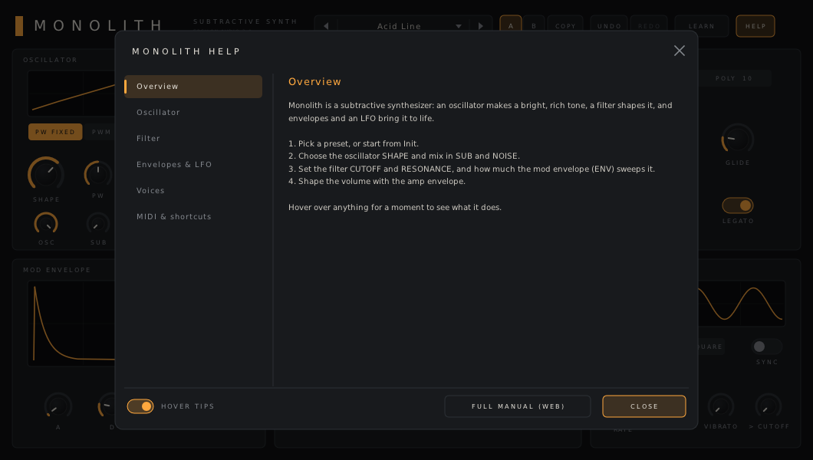
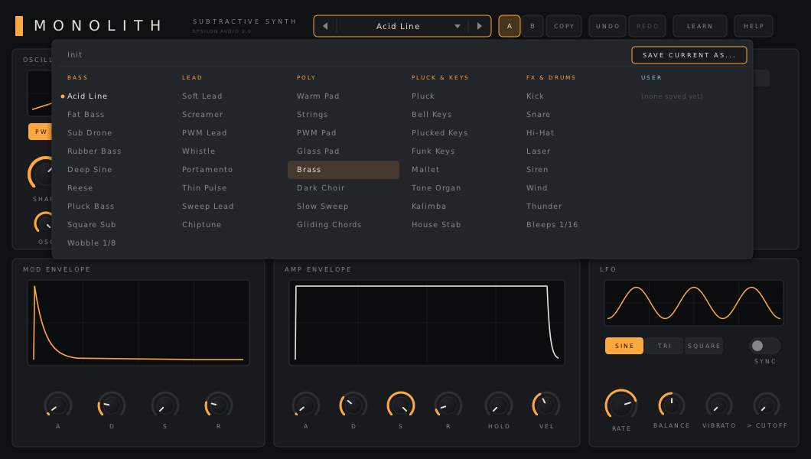

# Monolith

**A subtractive synthesizer plugin, mono or 10-voice poly, for macOS, Windows and Linux (VST3 · AU · CLAP · VST2).**

Part of **[Epsilon Audio](https://github.com/natehouk/epsilon-plugins)**, a family of free, open-source plugins: Monolith, Caldera, Obsidian, Strata, Basalt, Gneiss, Mica, Flint, Granite, Magma, Schist, Slate, Talc, Geode and Malachite.


Monolith is a clean-room design with the same feature set as FabFilter One, FabFilter's first synthesizer (2002), plus a few extras. It was written from scratch, working only from FabFilter's public product description and help pages. No FabFilter code, binaries, presets, artwork or trademarks were used. The DSP is built from published, textbook techniques:

- PolyBLEP band-limited oscillators
- a Zavalishin topology-preserving state-variable filter
- one-pole envelope segments
- Paul Kellet's pink-noise filter

## Download

Get the latest build from [**Releases**](../../releases). Each zip holds one platform:

| Platform | File | Contains |
|---|---|---|
| macOS 10.13+ (Apple Silicon + Intel) | `Monolith-macos-universal.zip` | VST3, AU, CLAP, manual |
| Windows x64 | `Monolith-windows-x64.zip` | VST3, CLAP, VST2, manual |
| Linux x64 | `Monolith-linux-x64.zip` | VST3, CLAP, VST2, manual |

### Install

| Platform | Copy | To |
|---|---|---|
| macOS | `Monolith.vst3` / `Monolith.component` / `Monolith.clap` | `~/Library/Audio/Plug-Ins/VST3` / `Components` / `CLAP` |
| Windows | `Monolith.vst3` (folder) / `Monolith.clap` | `C:\Program Files\Common Files\VST3\` / `CLAP\` |
| Linux | `Monolith.vst3` / `Monolith.clap` | `~/.vst3/` / `~/.clap/` |

**macOS:** builds are notarized once the project's Apple signing credentials are set up. Until then they are ad-hoc signed; after copying, clear the download quarantine and rescan in your DAW:

```
xattr -dr com.apple.quarantine ~/Library/Audio/Plug-Ins/*/Monolith*
```

**Windows:** the binaries are unsigned and statically linked, so no runtime install is needed.

## Features

**Oscillator**
- One continuously morphing waveform: sine ▸ triangle ▸ saw ▸ pulse. It is band-limited, so there's no aliasing.
- **Pulse width** with a **PWM source** switch:
  - *Fixed*
  - *LFO*
  - *Mod Env*
  - *Mod Env inverted*

  When a PWM source is on, the PW knob becomes the modulation depth.
- **Pitch Env:** the mod envelope bends pitch by up to ±24 semitones, with negative amounts inverting it. Useful for kicks, zaps and plucks.
- Octave (±2), Fine (±100 cents).
- Mixer:
  - **Osc** level
  - **Sub** (square, one octave down)
  - **Noise**, switchable **white / pink**

  Turn Osc to 0 for pure noise sounds.

**Filter**
- 12 dB/oct state-variable filter: **low pass / band pass / high pass**.
- Cutoff 20 Hz–20 kHz, **Resonance** up to stable self-oscillation, **Drive**.
- Cutoff modulation:
  - mod envelope (bipolar)
  - LFO
  - key tracking
  - velocity

**Envelopes**
- **Mod envelope** (ADSR): drives filter cutoff, pitch and PWM.
- **Amp envelope** (ADSR) with **velocity** amount.
- **Hold** (0–5 s): after you release a key, the note keeps sustaining for this long before the release starts. That lets the next note overlap the previous one. The hold region is shaded on both envelope displays.

**LFO**
- **Sine / triangle / square**, with **Balance**:
  - for triangle and sine, it skews the shape from a falling ramp through symmetric to a rising ramp
  - for square, it sets the duty cycle
- **Free rate** (0.05–20 Hz) or **Sync** to host tempo and song position: 16 bars … 1/64.
- Destinations:
  - **Vibrato** (pitch, up to ±24 st)
  - **> Cutoff**
  - PWM, via the PWM source switch

**Voice**
- **Mono** (last-note priority, optional **Legato**) or **Poly** (10 voices with voice stealing).
- **Glide** in both modes: in poly, new notes slide from the previously played note.
- Pitch-bend range 0–12 st, mod wheel → vibrato, **sustain pedal** (CC64), all-notes-off / all-sound-off.

**Interface and workflow**
- Live oscillator scope, filter response curve, envelope and LFO displays.
- **A/B** with copy, and **undo/redo** for every edit, including preset loads and A/B switches.
- **MIDI Learn:** assign any control to a hardware knob or fader; assignments are saved with the project.
- **Resizable:** drag the window corner. The layout keeps its aspect ratio and scales sharply on HiDPI screens.
- Every parameter is automatable, with smoothing on cutoff, resonance, drive, levels, pulse width and volume, so there's no zipper noise.
- **Hover tips** everywhere, a **HELP window**, and a **[full manual](docs/MANUAL.md)** (also in every release zip as `Monolith-Manual.html`).

| Action | Result |
|---|---|
| Drag up/down | Adjust a knob (hold **Shift** for fine) |
| Grab the rim of a large knob | Turn it in a circle |
| Mouse wheel | Step the value |
| **Double-click** | Type an exact value (e.g. `440`, `1.2k`, `250ms`, `-12`, `1/8`), then **Enter**. **Esc** cancels |
| **Cmd-click** (macOS) / **Ctrl-click** | Reset to default |
| Hover | Show the current value, then a tip |
| **Cmd/Ctrl-Z**, **Cmd/Ctrl-Shift-Z** | Undo, redo |



**Presets:** 42 factory sounds in five categories (Bass, Lead, Poly, Pluck & Keys, FX & Drums), plus your own.



- Click the preset name to open the browser; **SAVE CURRENT AS…** stores your own sounds as plain-text files that work on every system.
- Use **◀ ▶** or the mouse wheel over the name to step through factory and user presets.
- The preset browser **searches** names and categories as you type, and a star keeps a preset in **Favourites**.
- A `*` after the name means you've edited the sound since loading it.

### Compared with FabFilter One

| FabFilter One | Monolith |
|---|---|
| Triangle / saw / square / noise oscillator | ✓ (continuous morph + sine) |
| Pulse width + PWM (off / MG / EG / EG inverted) | ✓ |
| Octave scale + detune | ✓ |
| White / pink noise | ✓ |
| Portamento, also in poly | ✓ |
| Self-oscillating 12 dB low-pass | ✓ (+ band pass, high pass, drive) |
| Cutoff mod from EG (± invert), MG, velocity, key tracking | ✓ |
| Envelope with Hold | ✓ (+ a second, separate mod envelope) |
| EG → oscillator pitch (± invert) | ✓ |
| LFO triangle / square with balance, tempo sync 16 bars–1/64 | ✓ (+ sine) |
| Mono / 10-voice poly | ✓ (+ legato, sustain pedal) |
| Velocity → volume and cutoff | ✓ |
| Typed values, Cmd/Ctrl-click reset, value display, scaling | ✓ |
| MIDI Learn | ✓ |
| Undo/redo, A/B | ✓ |
| Preset saving | ✓ plain-text user presets |
| Help with interactive hints | ✓ hover tips, help pages and full manual |
| 100+ factory presets | 42 |
| AAX / AudioSuite (Pro Tools) | not supported (needs Avid's SDK and signing) |

## Build from source

The plugin is built on [DPF](https://github.com/DISTRHO/DPF):

```
git clone --recursive https://github.com/DISTRHO/DPF.git dpf
make -C plugins/Monolith                     # native: Linux / macOS (macOS also builds the AU)
make -C plugins/Monolith WINDOWS=true CC=x86_64-w64-mingw32-gcc CXX=x86_64-w64-mingw32-g++   # Windows cross-build
```

Linux needs `libgl1-mesa-dev libx11-dev libxext-dev libxrandr-dev libxcursor-dev libdbus-1-dev`.

GitHub Actions (`.github/workflows/build.yml`) builds all three platforms on every push. The macOS build is universal and ad-hoc signed. Pushing a version tag such as `v1.3`, or publishing a GitHub release, attaches the zips to that release.

## Tests

```
cd tests
g++ -O2 -std=c++11 features.cpp -o features && ./features   # poly, stealing, hold, sustain, pink noise, PWM, pitch env, LFO
g++ -O2 -std=c++11 fuzz.cpp -o fuzz && ./fuzz               # random params + MIDI at 44.1–192 kHz: no NaN/Inf, peak ≤ 0 dBFS
g++ -O2 -std=c++11 presets.cpp -o presets && ./presets      # renders every factory preset
```

Release checks:
- Steinberg's VST3 validator passes 47/47.
- The interface is exercised with scripted input under a virtual display: knob drags, segment switches, toggles, typed entry, Ctrl-click reset, the preset menu, saving a user preset, A/B, undo, MIDI Learn, hover tips, help and window resizing.

## Source layout

| File | Contents |
|---|---|
| `plugins/Monolith/MonoEngine.hpp` | All DSP: voices, oscillator, filter, envelopes, LFO. Header-only, no framework dependency |
| `plugins/Monolith/ParamDefs.hpp` | Parameter table, switch labels and value mapping, shared by DSP and UI |
| `plugins/Monolith/Presets.hpp` | Factory presets (each lists only what it changes from the defaults) |
| `plugins/Monolith/UserPresets.hpp` | User preset files |
| `plugins/Monolith/Help.hpp` | Hover tip text and in-plugin help pages |
| `plugins/Monolith/MonolithPlugin.cpp` | Plugin wrapper: parameters, programs, MIDI, MIDI Learn, host transport |
| `plugins/Monolith/MonolithUI.cpp` | Custom vector interface (NanoVG) |
| `docs/MANUAL.md` | User manual (`Monolith-Manual.html` is generated from it with pandoc) |

New parameters are always appended to the end of the list, so automation and saved sessions from older versions keep working.

## Changelog

- **2.1:** the preset browser searches names and categories as you type, and keeps Favourites.
- **2.0:** A/B with copy, undo/redo, MIDI Learn, user presets, hover tips, a help window and a full manual (in every release zip). Sessions and automation from 1.x load unchanged.
- **1.3:** Mono / 10-voice poly, Hold, sustain pedal, PWM sources, pink noise and osc level, pitch envelope, LFO waveforms with balance and tempo sync, resizable UI, typed value entry, Cmd/Ctrl-click reset, 42 categorized presets. Vibrato depth now goes up to ±24 st (it uses a square-law curve, so small settings stay subtle). Relicensed under MIT.
- **1.2:** Preset selector in the plugin header.
- **1.1:** Custom interface, macOS universal build.
- **1.0:** First release: mono synth engine, VST3/CLAP/VST2 for Windows and Linux.

## License

Monolith is released under the [MIT License](LICENSE).

It's built with [DPF](https://github.com/DISTRHO/DPF) and the NanoVG library bundled with it. `plugins/Monolith/ResizeHandle.hpp` comes from DPF's examples. Both are under the permissive ISC license, and their notices are kept in their files.

"FabFilter" and "FabFilter One" are trademarks of FabFilter Software Instruments. Monolith is not affiliated with or endorsed by FabFilter.
