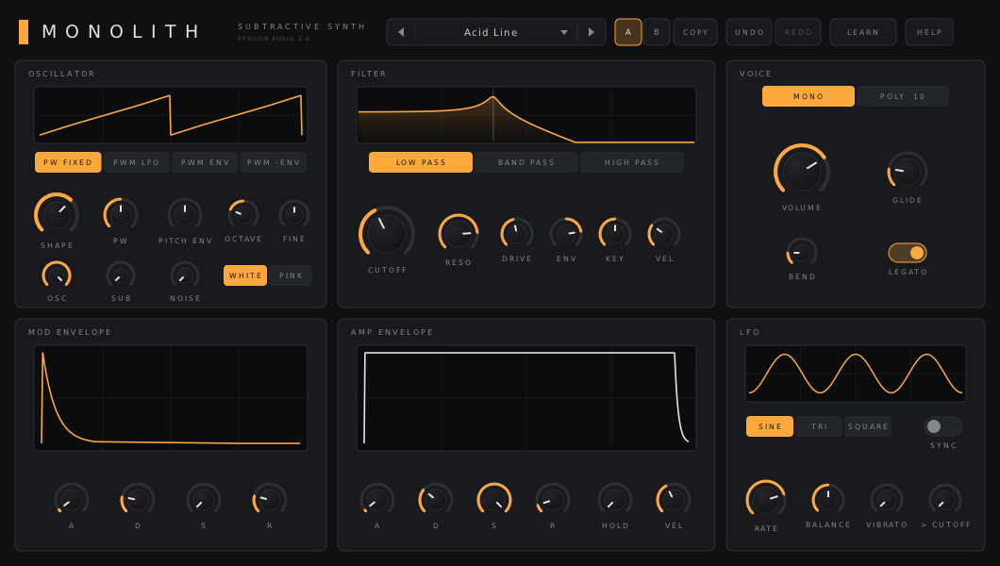

# Monolith 2.0 — User Manual

Monolith is a subtractive synthesizer. A single morphing oscillator, a sub oscillator and noise go through a resonant multimode filter, shaped by two envelopes and an LFO. It plays as a monophonic synth or with ten voices. Typical uses:

- basses, from round sub bass to squelchy acid lines
- leads with glide and vibrato
- pads, keys and plucks in poly mode
- kicks, snares, hats and effects from the pitch envelope and noise

Monolith runs as VST3, AU, CLAP and VST2 on macOS, Windows and Linux.

**Contents**

1. [Installing](#1-installing)
2. [A quick tour](#2-a-quick-tour)
3. [The oscillator](#3-the-oscillator)
4. [The filter](#4-the-filter)
5. [The envelopes](#5-the-envelopes)
6. [The LFO](#6-the-lfo)
7. [Voices and playing](#7-voices-and-playing)
8. [Knobs](#8-knobs)
9. [A/B, undo and redo](#9-ab-undo-and-redo)
10. [MIDI Learn](#10-midi-learn)
11. [Presets](#11-presets)
12. [Help and hover tips](#12-help-and-hover-tips)
13. [Recipes](#13-recipes)
14. [Parameter reference](#14-parameter-reference)
15. [Troubleshooting](#15-troubleshooting)

---

## 1. Installing

Download the zip for your system from the project's **Releases** page and copy the plugin files:

| System | Copy | To |
|---|---|---|
| macOS | `Monolith.vst3`, `Monolith.component` (AU), `Monolith.clap` | `~/Library/Audio/Plug-Ins/VST3`, `.../Components`, `.../CLAP` |
| Windows | the `Monolith.vst3` folder, `Monolith.clap` | `C:\Program Files\Common Files\VST3\`, `...\CLAP\` |
| Linux | `Monolith.vst3`, `Monolith.clap` | `~/.vst3/`, `~/.clap/` |

**macOS:** if the build isn't notarized and macOS blocks it, open Terminal and run:

```
xattr -dr com.apple.quarantine ~/Library/Audio/Plug-Ins/*/Monolith*
```

Rescan plugins in your DAW. Monolith appears under **Epsilon Audio** as an instrument.

Projects saved with Monolith 1.x open unchanged in 2.0.

---

## 2. A quick tour



- **Header:** the preset browser, **A / B** and **COPY**, **UNDO / REDO**, **LEARN** (MIDI Learn) and **HELP**.
- **Top row:**
  - **OSCILLATOR:** a scope, the PWM source switch, SHAPE, PW, PITCH ENV, OCTAVE, FINE, and the mixer (OSC, SUB, NOISE, white or pink)
  - **FILTER:** the response curve, the mode switch, CUTOFF, RESO, DRIVE, and the cutoff modulation amounts ENV, KEY and VEL
  - **VOICE:** MONO or POLY, VOLUME, GLIDE, BEND and LEGATO
- **Bottom row:**
  - **MOD ENVELOPE:** its shape, and A, D, S, R
  - **AMP ENVELOPE:** its shape, A, D, S, R, HOLD and VEL
  - **LFO:** its shape, the waveform switch, SYNC, RATE, BALANCE, VIBRATO and > CUTOFF

---

## 3. The oscillator

- **SHAPE** morphs continuously from **sine** to **triangle** to **saw** to **pulse**. Settings in between blend neighbouring shapes. The oscillator is band-limited, so high notes don't alias.
- **PW** sets the pulse width.
- The **PWM** switch picks what moves the pulse width:
  - **PW FIXED:** nothing
  - **PWM LFO:** the LFO
  - **PWM ENV:** the mod envelope
  - **PWM -ENV:** the mod envelope upside down

  With a source on, the PW knob is relabelled **PWM DEPTH** and sets how far the width moves.
- **PITCH ENV** bends the pitch with the mod envelope, up to 24 semitones either way. Negative settings bend down. Use it for kicks, zaps and plucks.
- **OCTAVE** (two down to two up) and **FINE** (±100 cents) tune the oscillator.
- **The mixer:**
  - **OSC:** the main oscillator
  - **SUB:** a square wave one octave down
  - **NOISE:** **WHITE** (bright hiss) or **PINK** (darker, even across octaves)

  Turn OSC down for pure noise sounds.

---

## 4. The filter

- **Mode:** **LOW PASS**, **BAND PASS** or **HIGH PASS**, 12 dB per octave.
- **CUTOFF** sets where the filter works, 20 Hz to 20 kHz.
- **RESO** emphasises the frequencies around the cutoff. Near the top the filter rings and sings on its own (self-oscillation). With KEY at 100% you can play it as a sine wave.
- **DRIVE** pushes the filter input for warmth and grit.
- **Cutoff modulation:**
  - **ENV:** the mod envelope, up to six octaves, up (positive) or down (negative)
  - **KEY:** the keyboard; at 100% the cutoff follows the pitch exactly
  - **VEL:** velocity; harder playing opens the filter more
  - **> CUTOFF** in the LFO panel: the LFO, up to two octaves either way

The response curve above the knobs shows the current mode, cutoff and resonance.

---

## 5. The envelopes

Monolith has two ADSR envelopes:

- The **MOD ENVELOPE** moves the filter cutoff (ENV), the pitch (PITCH ENV) and, if chosen, the pulse width.
- The **AMP ENVELOPE** shapes the volume. **VEL** sets how much velocity changes it; at 0% every note is equally loud.

Each has **A**ttack, **D**ecay, **S**ustain and **R**elease. Times go up to five seconds; the knobs give the short times most of their travel.

**HOLD** (0-5 s) keeps both envelopes sustaining for a while after you release a key, before the release starts. A new note can overlap the previous one. The hold region is shaded in both envelope displays.

---

## 6. The LFO

- **Waveform:** **SINE**, **TRI** or **SQUARE**.
- **BALANCE** skews the shape:
  - for sine and triangle, from a falling ramp through symmetric (50%) to a rising ramp
  - for square, it sets the duty cycle
- **RATE** is free-running from 0.05 to 20 Hz. With **SYNC** on, RATE picks a note length from 16 bars to a 64th note, locked to the host tempo and song position.
- **Destinations:**
  - **VIBRATO:** pitch, up to 24 semitones; small settings stay subtle
  - **> CUTOFF:** the filter
  - the pulse width, with the PWM switch set to PWM LFO

---

## 7. Voices and playing

- **MONO** plays one note at a time, the last you pressed. Release it and a note still held comes back.
  - **LEGATO:** notes played while another is held don't restart the envelopes. LEGATO is greyed out in poly mode.
- **POLY** plays up to ten notes. An eleventh note takes over the oldest.
- **GLIDE** slides the pitch between notes, up to two seconds. It works in both modes; in poly, new notes glide from the last note played.
- **BEND** sets the pitch-bend range, up to 12 semitones.
- The **mod wheel** adds vibrato. The **sustain pedal** (CC64) holds notes. All Notes Off and All Sound Off are honoured.

---

## 8. Knobs

- **Drag** up or down; hold **Shift** for fine adjustment.
- **Grab the rim** of a large knob (CUTOFF, VOLUME, RESO, SHAPE, GLIDE, RATE) to turn it in a circle.
- **Mouse wheel** turns a knob.
- **Double-click** to type a value, in the units shown: `440`, `1.2k`, `250ms`, `-12`, `saw`, `1/8`. **Enter** applies it, **Esc** cancels.
- **Cmd-click** (macOS) or **Ctrl-click** resets to the default.
- While the pointer is over a knob, its label shows the current value.

---

## 9. A/B, undo and redo

- **A / B** hold two complete sounds. Click the other letter to switch; the first time, B starts as a copy of A.
- **COPY** copies the current sound into the other slot.
- Every edit is an undo step, including preset loads and A/B switches. Monolith remembers the last 200.
  - Undo: **UNDO**, or Cmd/Ctrl-Z
  - Redo: **REDO**, or Cmd/Ctrl-Shift-Z or Cmd/Ctrl-Y

---

## 10. MIDI Learn

1. Click **LEARN**.
2. Click a knob or switch.
3. Move a knob or fader on your controller.
4. Click **LEARN** again (or press Esc) to finish.

- In learn mode each assigned control shows its controller number.
- Right-click a control to unassign it.
- **CLEAR ALL** (top right of the VOICE panel) removes every assignment.
- Assignments are saved with your project.
- The sustain pedal (CC64) and the channel-mode messages (CC120 and up) can't be learned.
- Learning CC1 replaces its usual vibrato job.

---

## 11. Presets

There are 42 factory sounds in five groups, plus your own:

| Group | Presets |
|---|---|
| Bass | Acid Line, Fat Bass, Sub Drone, Rubber Bass, Deep Sine, Reese, Pluck Bass, Square Sub, Wobble 1/8 |
| Lead | Soft Lead, Screamer, PWM Lead, Whistle, Portamento, Thin Pulse, Sweep Lead, Chiptune |
| Poly | Warm Pad, Strings, PWM Pad, Glass Pad, Brass, Dark Choir, Slow Sweep, Gliding Chords |
| Pluck & Keys | Pluck, Bell Keys, Plucked Keys, Funk Keys, Mallet, Tone Organ, Kalimba, House Stab |
| FX & Drums | Kick, Snare, Hi-Hat, Laser, Siren, Wind, Thunder, Bleeps 1/16 |

**Init** is a plain starting point.

**Browsing**
- Click the preset name to open the browser.
- **◀ ▶**, or the mouse wheel over the name, step through factory and user presets.
- **Search:** with the browser open, just type: the list narrows to presets whose name or category matches. Backspace edits, Esc clears the search (and then closes the browser).
- **Favourites:** click the star at the right of any preset to add it to the FAVOURITES column; click again to remove it. Favourites are kept in `favourites.txt` in your presets folder.
- A `*` after the name means you have changed the sound since loading it.

**Your own presets**
- **SAVE CURRENT AS…** in the browser stores your own sounds, in one of these folders:
  - macOS: `~/Library/Audio/Presets/Epsilon Audio/Monolith`
  - Windows: `%APPDATA%\Epsilon Audio\Monolith\Presets`
  - Linux: `~/.config/epsilon-audio/monolith/presets`
- Preset files are plain text and work on every system.
- To delete one, right-click it in the browser and click again to confirm.

---

## 12. Help and hover tips

- Rest the pointer on any control, display or header button to see what it does and its current value.
- **HELP** opens the in-plugin pages. The switch at the bottom of the help window turns hover tips on or off.
- **FULL MANUAL (WEB)** opens this manual.

---

## 13. Recipes

- **Acid line:**
  - MONO, LEGATO on, a little GLIDE
  - SHAPE at saw, OCTAVE -1
  - CUTOFF low, RESO 80%, ENV 60%, mod envelope decay short with sustain 0
  - add DRIVE
- **Fat bass:** SHAPE between saw and pulse, SUB 70%, OCTAVE -1, CUTOFF around 600 Hz, a short filter envelope.
- **Self-oscillating whistle:** OSC 0, RESO all the way up, KEY 100%; play the filter.
- **Kick:**
  - SHAPE sine, OCTAVE -1
  - PITCH ENV around +20 st with a very short mod envelope decay
  - amp decay about 0.35 s, sustain 0
- **Pad:**
  - POLY
  - slow amp attack and release
  - a slow filter envelope
  - a slow LFO to > CUTOFF
- **Tempo wobble:** LFO SYNC on, RATE 1/8, > CUTOFF high, RESO 60%.
- **Overlapping lead:** MONO with HOLD 0.2-0.5 s and GLIDE: released notes keep ringing into the next one.

---

## 14. Parameter reference

There are 39 automatable parameters. New parameters are only ever added at the end, so sessions and automation keep working across versions.

- **Oscillator:**
  - Osc Shape, Pulse Width, PWM Source (Off, LFO, Mod Env, Mod Env Inv), Pitch Env Amt (±24 st)
  - Octave (±2), Fine Tune (±100 ct)
  - Osc Level, Sub Osc, Noise, Noise Type (White, Pink)
- **Filter:**
  - Filter Mode (Low Pass, Band Pass, High Pass), Cutoff (20 Hz-20 kHz), Resonance, Drive
  - Filter Env Amt (±100%), Key Track, Filter Vel Amt
- **Mod envelope:** Filter Attack, Filter Decay, Filter Sustain, Filter Release.
- **Amp envelope:** Amp Attack, Amp Decay, Amp Sustain, Amp Release, Amp Vel Amt, Hold (0-5 s).
- **LFO:**
  - LFO Wave (Sine, Triangle, Square), LFO Balance
  - LFO Rate (0.05-20 Hz), LFO Sync, LFO Sync Rate (16 bars-1/64)
  - Vibrato, LFO > Cutoff
- **Voice:** Voice Mode (Mono, Poly), Glide (0-2 s), Legato, Bend Range (0-12 st), Volume (-36 to +6 dB).

MIDI Learn assignments are saved as part of the plugin's state. Monolith also has one output parameter that hosts may list; it only passes MIDI Learn messages to the interface.

---

## 15. Troubleshooting

- **Monolith doesn't appear in my DAW.** Check the install folders above and rescan plugins. On macOS, run the `xattr` command from section 1.
- **No sound.** Check that the track's MIDI input reaches Monolith, and that VOLUME and the amp envelope sustain aren't at the bottom. With OSC, SUB and NOISE all at 0 there is nothing to hear.
- **The LFO doesn't follow the tempo.** Turn SYNC on. Monolith follows the song position while the host transport plays.
- **A MIDI controller moves the wrong knob.** Open LEARN, right-click the control to unassign it, or use CLEAR ALL.
- **Hover tips get in the way.** Turn them off with the switch at the bottom of the HELP window.
- **Latency:** Monolith has none.
